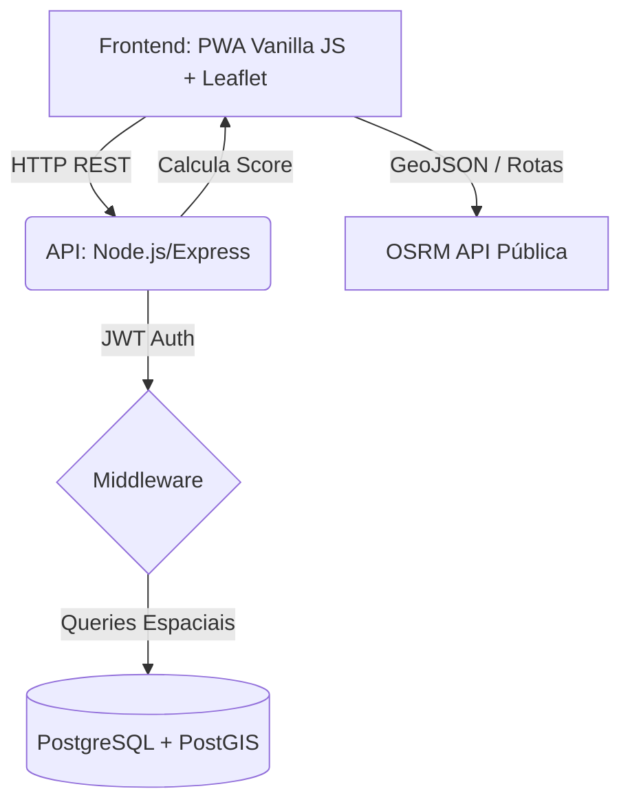

<div align="center">
  
  
  
  
  

  <h1>🚶‍♂️ Passo Livre</h1>
  <p><strong>Rotas Acessíveis Colaborativas para Cidades Mais Inclusivas</strong></p>
  <p>Projeto desenvolvido para a Global Solution 2026 - CitizenTech (Turma 2SIOA)</p>
  
</div>

---

## 📖 Sobre o Projeto

O **Passo Livre** é uma plataforma PWA (Progressive Web App) colaborativa que mapeia, valida e recomenda rotas acessíveis em tempo real. 

A solução resolve um problema crítico: mapas tradicionais não informam as condições reais das calçadas, rampas e iluminação. Isso gera isolamento e dependência para pessoas com mobilidade reduzida (cadeirantes, idosos, gestantes e cuidadores). Através do crowdsourcing, a própria comunidade mapeia os obstáculos urbanos, e nosso algoritmo calcula a rota mais segura com base no perfil de mobilidade do usuário.

---

## ✨ Funcionalidades

- 🔐 **Autenticação Segura:** Login e cadastro com JWT e senhas criptografadas (bcrypt).
- 📍 **Mapeamento Colaborativo:** Reporte de obstáculos (calçadas irregulares, rampas ausentes, buracos) com severidade de 1 a 5.
- 🗳️ **Validação Comunitária:** Os próprios usuários confirmam ou contestam os reportes (evitando fake news).
- 🗺️ **Roteamento com Score de Acessibilidade:** Cálculo de rota que avalia os obstáculos próximos e gera uma nota de 0 a 100.
- 📊 **Painel de Estatísticas:** Análise de dados agrupados para advocacy e tomada de decisão.

---

## 🛠️ Tecnologias Utilizadas

**Backend & Banco de Dados:**
* [Node.js](https://nodejs.org/) & [Express](https://expressjs.com/) - API RESTful
* [PostgreSQL](https://www.postgresql.org/) + [PostGIS](https://postgis.net/) - Banco de dados relacional com suporte geoespacial
* [JWT](https://jwt.io/) & [Bcrypt](https://www.npmjs.com/package/bcryptjs) - Segurança e Autenticação

**Frontend:**
* HTML5, CSS3 e JavaScript Vanilla
* [Leaflet](https://leafletjs.com/) e [OpenStreetMap](https://www.openstreetmap.org/) - Mapas interativos gratuitos
* PWA (Service Workers) - Instalável e com suporte offline básico

---

## 🏗️ Arquitetura do Sistema



---

## 🚀 Como Executar o Projeto

### Pré-requisitos
Você vai precisar de: [Node.js](https://nodejs.org/) e [Docker](https://www.docker.com/).

### 1. Subir o Banco de Dados (PostGIS)
```bash
docker run --name passo-pg -e POSTGRES_PASSWORD=postgres -e POSTGRES_DB=passolivre -p 5432:5432 -d postgis/postgis
```

### 2. Configurar o Backend
```bash
# Clone o repositório
git clone https://github.com/Peplui17/passo-livre.git
cd passo-livre/backend

# Instale as dependências
npm install

# Configure as variáveis de ambiente (.env)
cp .env.example .env
# Edite o .env com suas credenciais

# Crie as tabelas no banco
docker cp db/schema.sql passo-pg:/schema.sql
docker exec -i passo-pg psql -U postgres -d passolivre -f /schema.sql

# Popule o banco com dados de teste
npm run seed

# Inicie o servidor
npm run dev
```

### 3. Rodar o Frontend
Abra a pasta `frontend/index.html` com o **Live Server** no VSCode (ou use `npx serve frontend`).
* *Login de teste:* `ana@example.com` / `senha123`

---

## 🌍 Conexão com os ODS da ONU

Este projeto está diretamente alinhado com os Objetivos de Desenvolvimento Sustentável:
* **ODS 10 (Redução das Desigualdades):** Promove acessibilidade e autonomia para pessoas com deficiência.
* **ODS 11 (Cidades Sustentáveis):** Torna os espaços urbanos inclusivos, seguros e resilientes.
* **ODS 3 (Saúde e Bem-Estar):** Reduz riscos de acidentes e incentiva a mobilidade ativa.
* **ODS 9 (Inovação):** Utiliza infraestrutura digital e dados abertos para resolver problemas locais.
* **ODS 4 (Educação Inclusiva):** Acesso seguro a escolas e universidades.

---

## 👥 Equipe (Turma 2SIOA)

* **Luiz Otávio Fontes** - RM561537


---
<div align="center">
  <i>Desenvolvido com 💚 para um mundo mais acessível.</i>
</div>